<p align="center">
  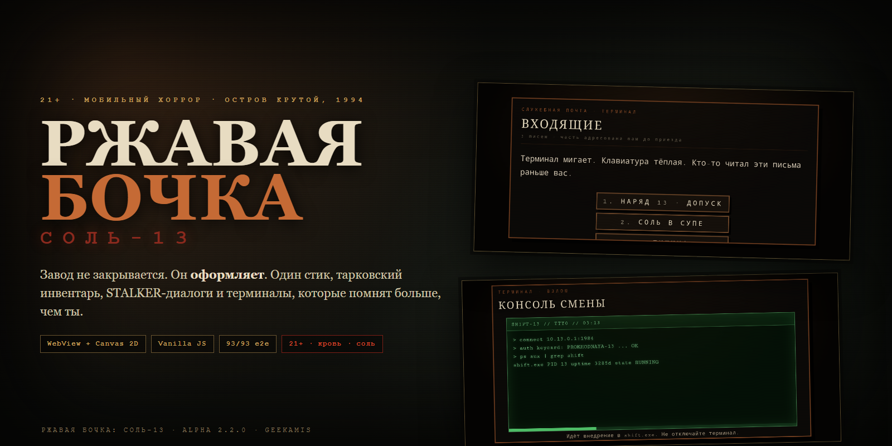
</p>

<h1 align="center">РЖАВАЯ БОЧКА: СОЛЬ-13</h1>

<p align="center">
  <b>2.5D хоррор-экшен на заброшенном рыбзаводе. Один стик. Тарковский инвентарь. Терминалы, которые знают о тебе больше, чем ты.</b><br>
  <sub>Остров Крутой · 1994 · наряд 13 · смена не заканчивается</sub>
</p>

<p align="center">
  <a href="https://geekamis.github.io/rusty-barrel-salt13/"></a>
  <a href="https://github.com/geekAmis/rusty-barrel-salt13/releases/latest"></a>
  
  
  
  
  
  
  
</p>

<p align="center">
  <a href="https://geekamis.github.io/rusty-barrel-salt13/">▶ Играть в браузере</a>
  &nbsp;·&nbsp;
  <a href="docs/rusty-barrel-trailer.mp4">▶ Трейлер, 52 секунды</a>
  &nbsp;·&nbsp;
  <a href="https://github.com/geekAmis/rusty-barrel-salt13/releases/latest">Скачать APK</a>
</p>

> «Смена не заканчивается. Она просто переходит на следующую».

**РЖАВАЯ БОЧКА: СОЛЬ-13** — мобильная игра, в которой инспектор рыбнадзора приезжает закрыть завод, официально мёртвый с 1985 года. Завод закрываться не собирается: у него на инспектора свои планы — оформить на должность.

Это не слайд-шоу и не прототип на движке. Это полностью играбельная alpha: пять глав, четыре концовки, восемь NPC с квестами, изометрические комнаты, боссы, расчленёнка, крафт, наркотическая зависимость, туман войны и десятки предметов одежды. Всё — на Canvas 2D, без Unity, Godot и игровых фреймворков.

<p align="center">
  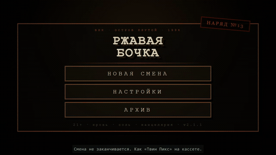
</p>

---

## Почему это не очередной зомби-шутер

| | |
|---|---|
| 🏭 **Производственный хоррор** | Страх не от «криков в темноте», а от «планёрки в темноте». Ведомости, бирки, печати, наряды, смена — ритуал. |
| 🧂 **Соль-13** | Не вирус и не зомби. Консервант памяти. Тело можно вырастить, память — скопировать. Завод производит не рыбу, а инспекторов. |
| 🖥️ **Живые терминалы** | Служебная почта и консоли смены на каждом уровне. Письма адресованы тебе до приезда. В консоли — `shift.exe`, `salt13.sys`, `inspector_copy4` и строка `copy 5: YOU`. |
| 🕹️ **Один стик** | <50% радиуса — прицел, >50% — движение и прицел. Второго стика нет. Единственная кнопка действия — контекстная плашка. |
| 🎒 **Тарковский инвентарь** | Сетка, вес, карманы, РПС, магазины, патроны по типам, объединение стаков, экипировка одежды. Всё, что подобрал или купил, попадает в сетку. |
| 🗣️ **STALKER-диалоги** | Портреты, реплики игрока, уровни и валюта NPC, торговля сеткой, новые вопросы, открывающиеся после почты/консоли/тайной комнаты. |
| 🧠 **Пасхалки с характером** | Прыжок на голову врага (Mario). Четыре прокачки силы ноги — красный плащ и лысина (One Punch Man). |
| 🩸 **21+ без компромиссов** | Кровь, расчленёнка, ползающие конечности, соль, вещества, канцелярия. |

---

## Скриншоты

<table>
<tr>
<td width="50%">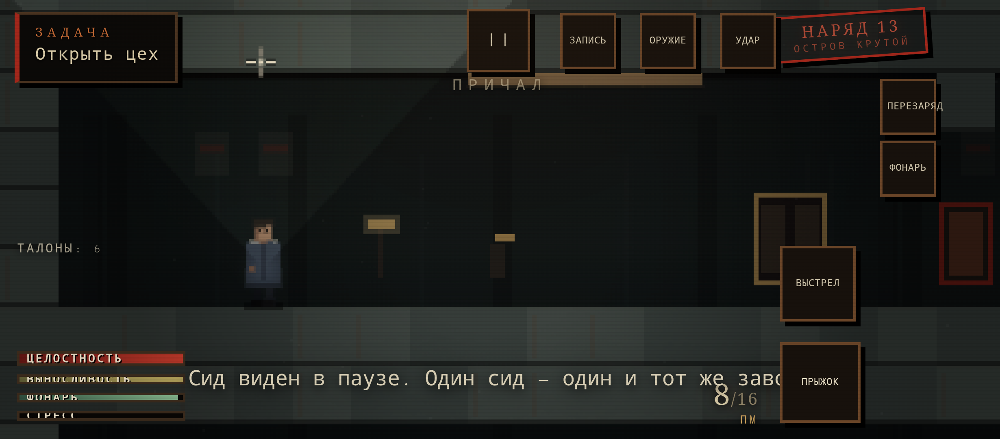<br><sub><b>Геймплей.</b> Один стик, фонарь, тьма и то, что стоит за дверью.</sub></td>
<td width="50%">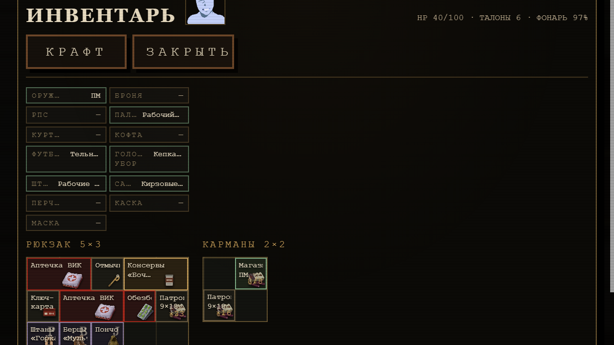<br><sub><b>Инвентарь.</b> Сетка, РПС, карманы, портрет героя по состоянию.</sub></td>
</tr>
<tr>
<td>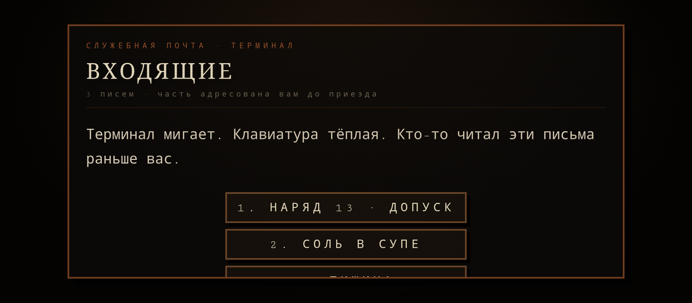<br><sub><b>Почта.</b> 15 писем, часть — до твоего приезда.</sub></td>
<td>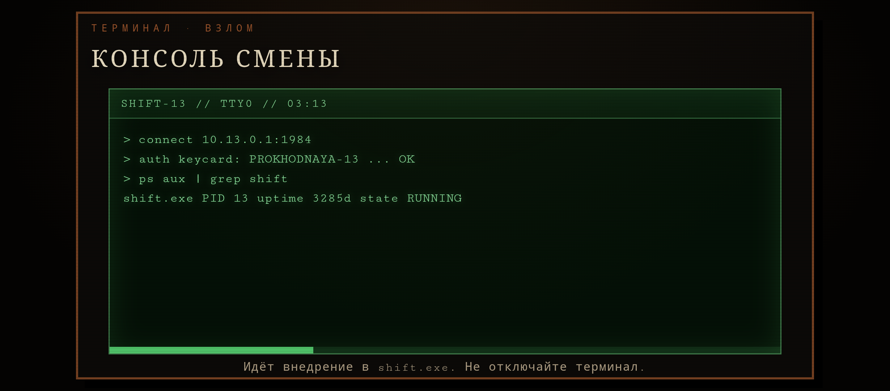<br><sub><b>Консоль смены.</b> Ключ-карта, взлом, 15 талонов и 3 соли-13.</sub></td>
</tr>
<tr>
<td>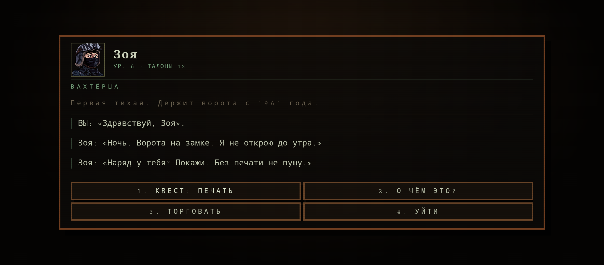<br><sub><b>STALKER-диалог.</b> Портрет, реплики, торговля и новые вопросы.</sub></td>
<td>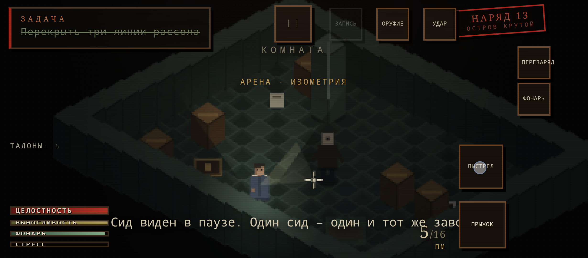<br><sub><b>Босс.</b> Только в изометрии, только после ключа и переговоров.</sub></td>
</tr>
<tr>
<td>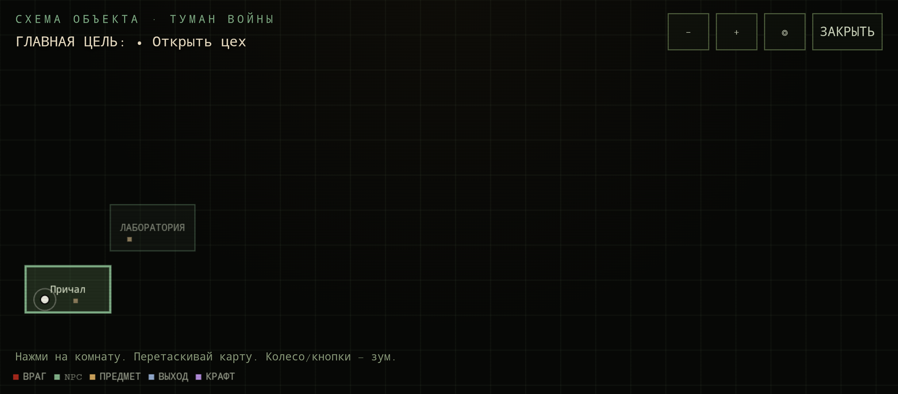<br><sub><b>Карта.</b> Туман войны, комнаты, враги, предметы, зум.</sub></td>
<td>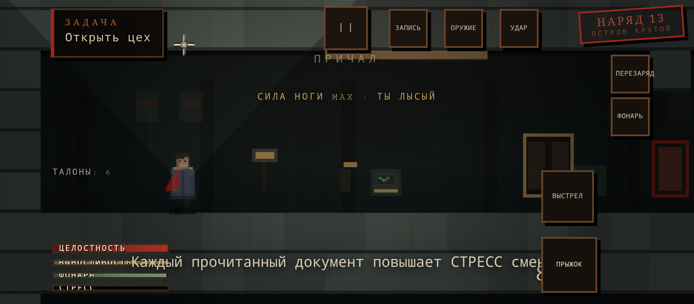<br><sub><b>One Punch Man.</b> 4 уровня силы ноги — плащ и лысина.</sub></td>
</tr>
</table>

---

## Что внутри

### Мир и сюжет
- **5 глав:** Проходная → Цех → Лаборатория → Архив → Кессон №9.
- **4 концовки:** ХОР, СОЛЬ, ЭМБАРГО, ТИХИЙ БЕРЕГ.
- **8 NPC с квестами:** Зоя, Гриша, Вера, Тимка, Ким, Слава, Игнат, Ася.
- **30 документов**, 10 катсцен, 4 босса, 7 типов врагов.
- **Новая линия «Наряд 13»:** почта и консоли раскрывают, что оригинал инспектора уехал в 1985-м, а на смене остались копии.

### Геймплей
- Платформер сбоку + изометрические комнаты за дверями.
- Один стик, контекстная кнопка действия, фонарь, заряд, дыхание, стресс.
- Твёрдые тела врагов, расчленение, ползающие конечности, добивание, пощада культиста.
- Боссы только в изометрии; ключи, переговоры, провал переговоров.
- **Mario-стomp:** прыжок на голову наносит урон и отбрасывает героя.
- **Прокачка силы ноги:** +25% урона за уровень, 4-й уровень открывает красный плащ и лысину.

### Инвентарь и предметы
- Сетка 5×3 + карманы 2×2 + РПС на 12 ячеек.
- Магазины и патроны: 9×18, 5.45, 12К, гарпун, огнемёт; бронебойные, трассирующие, дробь, пуля, зажигательные.
- Объединение патронов: клик по ячейке-получателю → клик по ячейке-источнику; drag&drop.
- Всё купленное/найденное попадает в инвентарь; при полном инвентаре покупка **падает на пол**.
- Выброшенный предмет падает в 46–88 px, проверяет стены и пол и не подбирается 0.9 секунды.
- 80+ предметов одежды: головные уборы, футболки, кофты, куртки, пончо, штаны (горка, флора, город, песок, зелёный камуфляж), берцы, кроссовки, кеды Vanes, броня, РПС.

### Терминалы и лор
- **Служебная почта:** 3 письма на главу, 15 всего. Юмор, канцелярия и очень серьёзные вещи.
- **Консоль смены:** ключ-карта из тайной комнаты каждой главы; хакерский экран с командами, процессами и прогрессом; награда 15 талонов + 3 соли-13.
- **Ключ-карты `keycard_1…5`:** всегда в тайной комнате уровня, расходуются при взломе.
- **Открывающиеся вопросы NPC:** после `mail_read`, `console_hacked` и `secret_found` у каждого NPC появляются новые ветки.

### Портрет героя
Только PNG из набора Prototype dialogue portraits. 7 состояний по целостности, отдельное лицо ломки при HP > 50% и лицо действия соли-13, которое перебивает остальные.

---

## Технологии

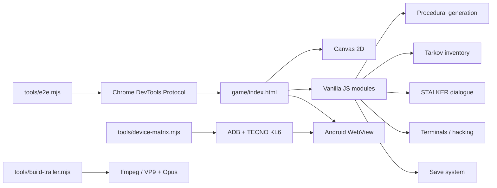

- **Движок:** WebView + Canvas 2D, без Unity/Godot. Почему — в [`GODOT_EVAL.md`](GODOT_EVAL.md).
- **Язык:** vanilla JavaScript, ES modules, никаких фреймворков.
- **Генерация:** процедурные уровни, изометрические комнаты, проверка проходимости BFS, 10 000 уровней в валидаторе.
- **Мобильный ввод:** один виртуальный стик, контекстная кнопка, тач-лейаут.
- **Android:** WebView-обёртка, release APK/AAB, alpha-сборки на TECNO KL6.
- **Тесты:** e2e через CDP, матрица устройств через ADB, отдельные тесты сюжета и генератора.
- **Медиа:** трейлер записан покадрово через CDP screencast и собран ffmpeg (VP9/Opus + H.264/AAC).

---

## Быстрый старт

**Играть сразу в браузере:** [geekamis.github.io/rusty-barrel-salt13](https://geekamis.github.io/rusty-barrel-salt13/)

Или локально. Нужен **Node.js 20+**.

```bash
git clone https://github.com/geekAmis/rusty-barrel-salt13.git
cd rusty-barrel-salt13
node tools/serve.mjs 8123
```

Открой:

```text
http://127.0.0.1:8123
```

> Игра рассчитана на ландшафт телефона. В браузере — DevTools → Device Toolbar → 640×360.

### Сборка APK

Нужен Android SDK и JDK 17.

```powershell
powershell -ExecutionPolicy Bypass -File tools/build-apk.ps1 -Release -Alpha
```

> Скрипт рассчитан на Windows + Android SDK 34 + JDK. Пути к SDK/JDK заданы в начале `tools/build-apk.ps1` — поправь под свою машину. Альтернатива: открыть папку `android/` в Android Studio и собрать `assembleRelease`.

Результат:

```text
build/rustybarrel-release.apk
build/rustybarrel-release.aab
```

---

## Управление

| Действие | Как |
|---|---|
| Движение | Второй палец на левой половине, тянуть дальше 50% |
| Прицел | Тянуть стик меньше 50% |
| Стрельба | Кнопка «ВЫСТРЕЛ» |
| Перезарядка | «ПЕРЕЗАРЯД» / `R` |
| Удар ногой | «УДАР» / `X` |
| Фонарь | «ФОНАРЬ» / `F` |
| Запись времени | «ЗАПИСЬ» / `Q` |
| Прыжок | «ПРЫЖОК» / `Space` |
| Смена оружия | «ОРУЖИЕ» / `1–5` |
| Инвентарь | Пауза → «ИНВЕНТАРЬ» |
| Карта | `M` или Пауза → «КАРТА» |

---

## Тесты и качество

| Проверка | Команда | Результат |
|---|---|---|
| Синтаксис JS | `node --check game/js/*.js` | PASS |
| Платформенные уровни | `node tools/test-platform.mjs 2000` | 10 000 уровней, 0 ошибок |
| Сюжет/контент | `node tools/test-story.mjs` | 5 глав, 30 документов, 8 NPC, 4 концовки |
| E2E (CDP) | `node tools/e2e.mjs` | **93/93** |
| Матрица устройств | `node tools/device-matrix.mjs` | **47/47**, TECNO KL6 / Android 14 |
| APK | `tools/build-apk.ps1 -Release -Alpha` | 2.2.0-alpha, 21.4 МБ |

E2E требует запущенный сервер:

```bash
node tools/serve.mjs 8123
node tools/e2e.mjs
```

---

## Структура

```text
game/
  index.html          — точка входа
  js/                 — движок, рендер, ввод, сюжет, инвентарь, мини-игры
  assets/             — портреты, иконки, спрайты
  css/                — HUD и мобильный интерфейс
android/              — WebView-обёртка и Gradle-сборка
docs/                 — стори-библия, QA, ассеты, баланс, терминалы, трейлер
tools/                — сервер, e2e, матрица устройств, сборка APK и трейлера
roadmap-v2.json       — закрытый пул v2.0–v2.1
roadmap-v3.json       — закрытый пул v2.2
```

---

## Дорожная карта

- ✅ **v2.0** — Tarkov-инвентарь, магазины/патроны, одежда, РПС, карта, STALKER-диалоги, отмычки, крафт, наркотики, боссы.
- ✅ **v2.1** — мультимагазины, торговля сеткой, визуальные катсцены, объединение патронов, исправление перезарядки.
- ✅ **v2.2** — почта и консоли, ключ-карты в тайных комнатах, сюжет о копиях, новые вопросы NPC, PNG-иконки и портреты, Mario-стomp, One Punch Man, сила ноги.
- 🔜 **дальше** — EN-локализация новых терминалов, больше писем и веток, плейтест 6–9 часов, публикация в RuStore.

---

## Лицензия и ассеты

- **Код игры** — MIT, см. [`LICENSE`](LICENSE).
- **Графика и иконки** — бесплатные ассеты CraftPix (Free license, attribution not required), исходные паки не входят в репозиторий из-за размера; производные иконки и портреты лежат в `game/assets/`. Подробности — [`docs/ASSETS.md`](docs/ASSETS.md).
- **21+**: кровь, расчленёнка, телесный ужас, вещества. Это художественное произведение, не инструкция.

---

<p align="center">
  <b>РЖАВАЯ БОЧКА: СОЛЬ-13</b><br>
  Сделано на острове Крутой. Паром в 03:13.<br>
  <sub>geekAmis · 2026 · alpha 2.2.0</sub>
</p>
